# Daily Loaf — Architecture and Design

**Date:** 2026-11-11
**Status:** Draft, for review
**Repo:** `daily-loaf`

This is the complete design: architecture, data model, business rules, API, frontend, security, infrastructure and testing. It replaces `2026-11-03-bread-order-app-design.md` as the reference. The implementation plan is `../plans/2026-11-11-daily-loaf-implementation.md`.

Each diagram is a PNG in `diagrams/`, so it shows in any Markdown viewer (VS Code, GitHub). Its Mermaid source sits under it in a collapsed "Diagram source" section; edit the source and re-export the PNG when a diagram changes.

**Contents**
1. [Purpose and scope](#1-purpose-and-scope)
2. [System overview](#2-system-overview)
3. [Environments](#3-environments)
4. [Data model](#4-data-model)
5. [Business rules](#5-business-rules)
6. [API](#6-api)
7. [Backend architecture](#7-backend-architecture)
8. [Frontend architecture](#8-frontend-architecture)
9. [Key flows](#9-key-flows)
10. [Search and analysis](#10-search-and-analysis)
11. [Security](#11-security)
12. [Infrastructure](#12-infrastructure)
13. [Delivery pipeline](#13-delivery-pipeline)
14. [Testing](#14-testing)
15. [Observability and cost](#15-observability-and-cost)
16. [Key decisions](#16-key-decisions)
17. [Open points](#17-open-points)

---

## 1. Purpose and scope

### Goals
1. **Run the home bread business:** customers, orders, daily rates, monthly bills and payment tracking.
2. **Portfolio:** show full-stack skills that German employers ask for (including public-sector roles such as the BKA frontend developer posting) through a public GitHub repo and a live demo:
   - Angular with TypeScript;
   - Python with FastAPI;
   - PostgreSQL, Elasticsearch and Docker;
   - AWS, testing and CI/CD.

### Users

| User | Access |
|---|---|
| Admin (exactly 2 accounts) | Everything |
| Customer | No login; exists only as a record. Orders arrive by WhatsApp or phone and an admin enters them. |
| Demo visitor | Shared demo admin login with fake data (demo environment only) |

### Products and initial rates (from 2026-01-01)

| Code | Name | Price per piece |
|---|---|---|
| `MINI_PAV` | Mini pav | €0.40 |
| `MEDIUM_PAV` | Medium pav | €0.55 |
| `NORMAL_PAV` | Normal pav | €0.60 |
| `BROWNIE` | Brownie | €1.00 |
| `ROTI` | Roti | €1.00 |

### In scope
- Customer records: create, edit, deactivate and anonymise.
- Order entry, with a status workflow.
- Product rates with effective dates.
- Payments, adjustments and monthly balances carried forward.
- A monthly PDF bill per customer. As a Kleinunternehmer business, bills carry no VAT.
- Search and analysis across customers and orders.
- A dashboard.
- A mobile-friendly UI.
- Two deployed environments: a public `demo` and a private `prod`.

### Out of scope
- Customer logins or online ordering
- WhatsApp integration
- Online payments
- VAT
- Email and SMS
- A native mobile app

---

## 2. System overview

### 2.1 Context


<details>
<summary>Diagram source (Mermaid)</summary>

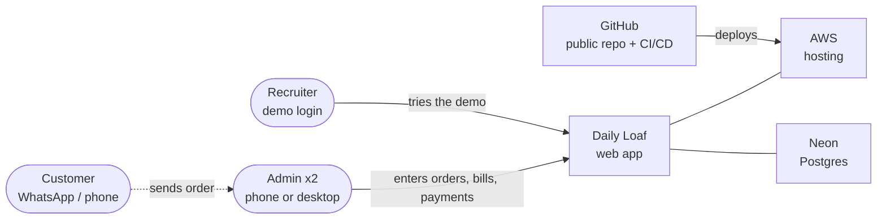

</details>

### 2.2 Deployed on AWS

Every request goes through CloudFront. Static files come from S3, and `/api/*` goes to the FastAPI Lambda. No server runs when nobody is using the app.


<details>
<summary>Diagram source (Mermaid)</summary>

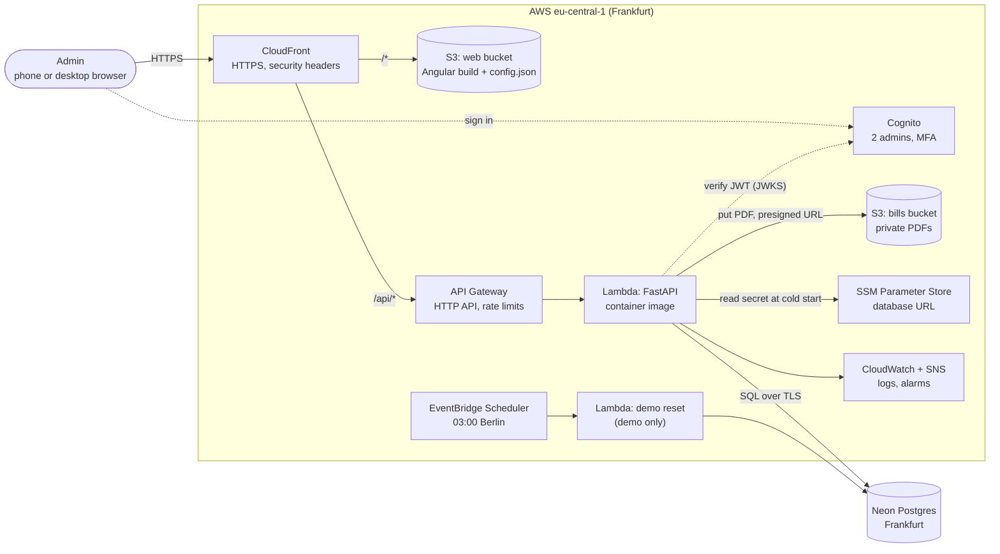

</details>

### 2.3 Local development

The same backend code runs on the laptop. Docker Compose provides Postgres, an S3 stand-in (MinIO) and Elasticsearch.


<details>
<summary>Diagram source (Mermaid)</summary>

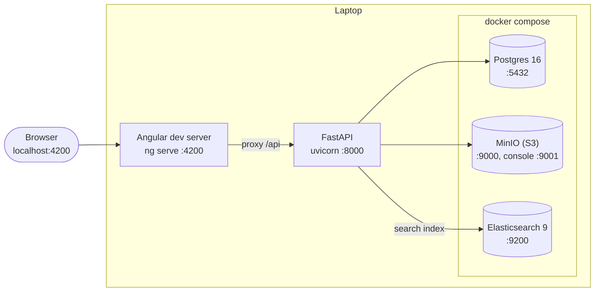

</details>

### 2.4 Technology stack

| Layer | Technology |
|---|---|
| Frontend | Current Angular (standalone components, signals, zoneless), TypeScript strict, RxJS, typed Reactive Forms, Angular Material + CDK, aws-amplify (auth only) |
| Backend | Python 3.12, FastAPI, Pydantic v2, SQLAlchemy 2, Alembic, psycopg 3, PyJWT, WeasyPrint + Jinja2, Mangum |
| Data | PostgreSQL 16 (Neon on AWS); Elasticsearch 9 (local and CI); S3 (MinIO locally) |
| Infrastructure | AWS: CloudFront, S3, API Gateway, Lambda, Cognito, SSM, ECR, EventBridge Scheduler, CloudWatch, SNS. Terraform. |
| Tooling | uv, npm, Docker Compose, GitHub Actions, Dependabot, pre-commit |
| Tests | pytest, Testcontainers, moto, time-machine, Angular test runner (Vitest), Angular Testing Library, Playwright |

---

## 3. Environments

| | Local | Demo | Prod |
|---|---|---|---|
| Who uses it | You, while coding | Recruiters, with the login in the README | You and the second admin |
| Data | Fake (seed script) | Fake, reset every night at 03:00 Berlin time | Real customers |
| Login | Dev token | Cognito, MFA off | Cognito, MFA required |
| Search backend | Elasticsearch | Postgres | Postgres |
| Database | Docker Postgres | Neon branch `demo` | Neon branch `main` |
| Deployed by | — | Every merge to `main` | A `v*` tag plus manual approval |
| Banner | — | "Demo — data resets nightly" | — |

Demo and prod each have their own database, Cognito pool, buckets and Lambdas. Demo can never reach prod data.


<details>
<summary>Diagram source (Mermaid)</summary>

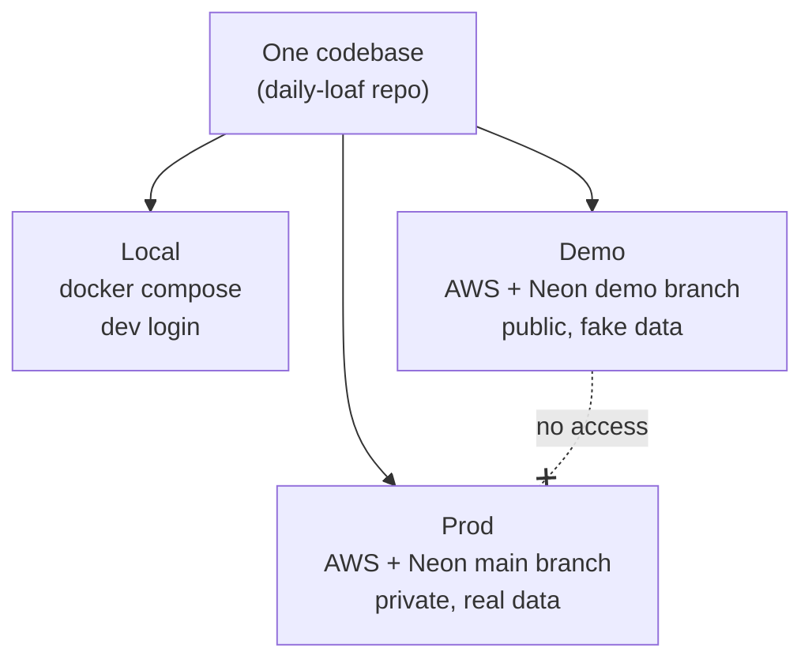

</details>

---

## 4. Data model

### 4.1 Conventions
- **Money:** whole cents (`integer`): €0.55 is `55`. Never floats.
- **Dates:** calendar dates in the Europe/Berlin time zone. Timestamps are `timestamptz`.
- **Months:** stored as the first day of the month (`2026-10-01`) and sent over the API as `"2026-10"`.
- **Audit columns:** every table except `billing_months` has `created_at`, `created_by`, `updated_at` and `updated_by`. `created_by` and `updated_by` hold the username.
- **No hard deletes of customers:** they are deactivated or anonymised instead.

### 4.2 Entity-relationship diagram


<details>
<summary>Diagram source (Mermaid)</summary>

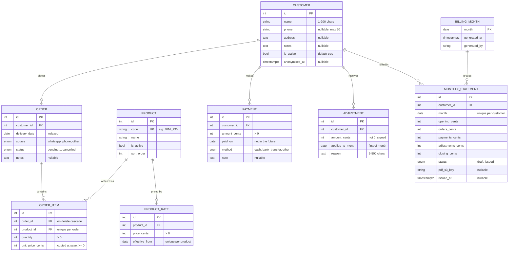

</details>

The `BILLING_MONTH` link is logical, by `month`, not a foreign key.

### 4.3 Tables in detail

| Table | Column | Type | Constraints and notes |
|---|---|---|---|
| `customers` | `id` | int identity | PK |
| | `name` | varchar(200) | not null, trimmed |
| | `phone` | varchar(50) | nullable |
| | `address`, `notes` | text | nullable |
| | `is_active` | boolean | default `true` |
| | `anonymised_at` | timestamptz | nullable; set once, never cleared |
| `products` | `id` | int identity | PK |
| | `code` | varchar(30) | unique |
| | `name` | varchar(100) | not null |
| | `is_active` | boolean | default `true` |
| | `sort_order` | int | display order (1–5) |
| `product_rates` | `id` | int identity | PK |
| | `product_id` | int | FK → products |
| | `price_cents` | int | CHECK > 0 |
| | `effective_from` | date | UNIQUE (`product_id`, `effective_from`) |
| `orders` | `id` | int identity | PK |
| | `customer_id` | int | FK → customers |
| | `delivery_date` | date | indexed |
| | `source` | enum `order_source` | `whatsapp` / `phone` / `other` |
| | `status` | enum `order_status` | see §5.1 |
| | `notes` | text | nullable |
| `order_items` | `id` | int identity | PK |
| | `order_id` | int | FK → orders, ON DELETE CASCADE |
| | `product_id` | int | FK → products; UNIQUE (`order_id`, `product_id`) |
| | `quantity` | int | CHECK > 0 |
| | `unit_price_cents` | int | CHECK ≥ 0; copied from the rate for the delivery date |
| `payments` | `id` | int identity | PK |
| | `customer_id` | int | FK → customers |
| | `amount_cents` | int | CHECK > 0 |
| | `paid_on` | date | not after today (Berlin), checked by the API |
| | `method` | enum `payment_method` | `cash` / `bank_transfer` / `other` |
| | `note` | text | nullable |
| `adjustments` | `id` | int identity | PK |
| | `customer_id` | int | FK → customers |
| | `amount_cents` | int | CHECK ≠ 0; positive adds to what is owed, negative reduces it |
| | `applies_to_month` | date | CHECK day = 1 |
| | `reason` | text | not null, 3–500 characters |
| `monthly_statements` | `id` | int identity | PK |
| | `customer_id` | int | FK → customers; UNIQUE (`customer_id`, `month`) |
| | `month` | date | first of month |
| | `opening_cents` … `closing_cents` | int | see §5.4 |
| | `status` | enum `statement_status` | `draft` / `issued` |
| | `pdf_s3_key` | varchar | `statements/YYYY-MM/<customer id>.pdf` once issued |
| | `issued_at` | timestamptz | nullable |
| `billing_months` | `month` | date | PK; one row per month that has been generated |
| | `generated_at`, `generated_by` | timestamptz, varchar(100) | |

### 4.4 Enums

| Enum | Values |
|---|---|
| `order_status` | `pending`, `confirmed`, `in_prep`, `delivered`, `cancelled` |
| `order_source` | `whatsapp`, `phone`, `other` |
| `payment_method` | `cash`, `bank_transfer`, `other` |
| `statement_status` | `draft`, `issued` |

### 4.5 Migrations
- Alembic manages the schema. The first migration creates the tables and enums; the second seeds the 5 products and their initial rates.
- Every migration must work in both directions (`upgrade` and `downgrade`).
- Deployments run `alembic upgrade head` before the new code goes live.

---

## 5. Business rules

### 5.1 Order status


<details>
<summary>Diagram source (Mermaid)</summary>

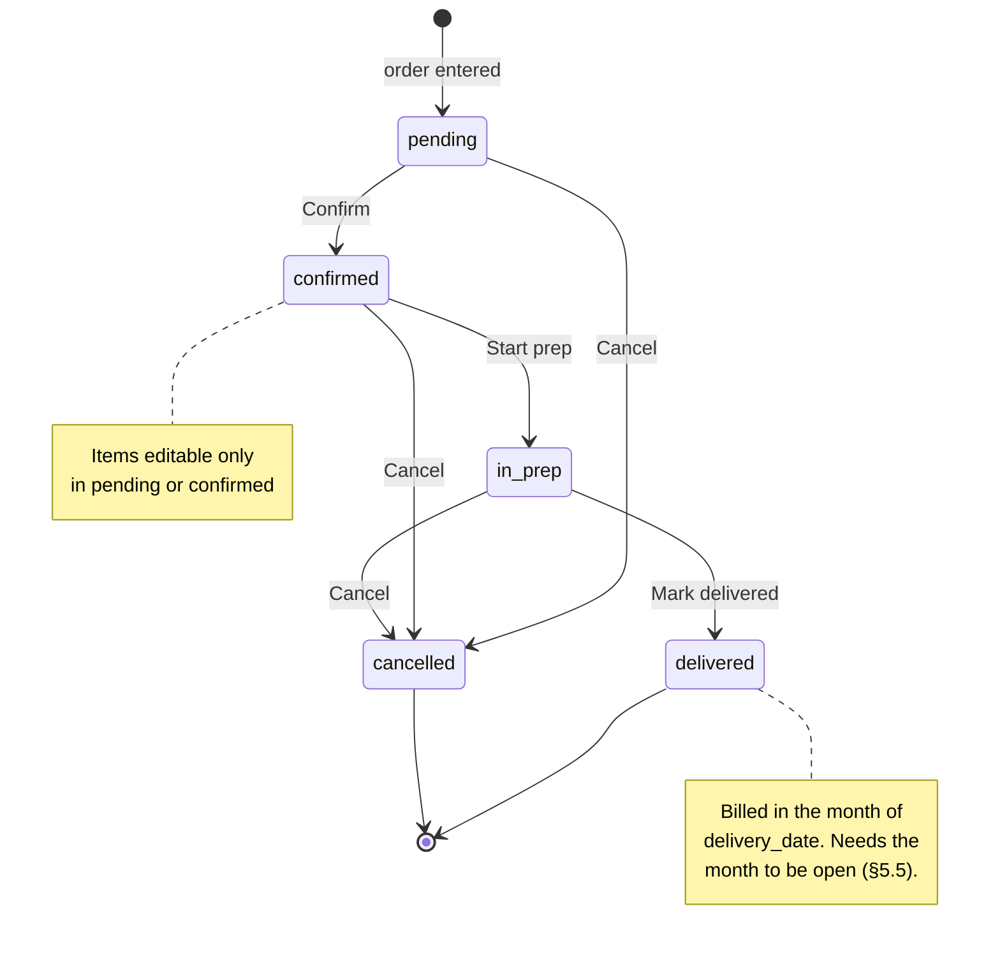

</details>

- Any other change is rejected with `INVALID_STATUS_TRANSITION`.
- A delivered order can't be edited or cancelled. Mistakes are fixed with an adjustment.
- Orders can't be placed for inactive or anonymised customers (`CUSTOMER_INACTIVE`).

### 5.2 Rates and price snapshots

The price for date D is the rate with the latest `effective_from` on or before D. If there is none, the order is rejected with `NO_RATE_FOR_DATE`.

**Example:** Medium pav costs 55 from 2026-01-01 and 60 from 2026-11-10.

| Delivery date | Price used |
|---|---|
| 2026-11-09 | 55 |
| 2026-11-10 | 60 |
| 2025-12-31 | rejected: no rate |

When an order is saved, each item's `unit_price_cents` is **copied** from that rate. Changing a rate later never changes existing orders or bills. Editing an order (only while `pending` or `confirmed`) copies the prices again for its possibly new date.

### 5.3 Billing rules
- Only `delivered` orders are billed, in the month of `delivery_date`.
- Payments count in the month of `paid_on`; adjustments in their `applies_to_month`.
- Months are billed in order. Month M can be generated only if:
  - no month has been generated yet, or
  - every statement for M−1 is issued.

  Otherwise it is rejected with `PREVIOUS_MONTH_NOT_ISSUED`. If a later month has already been generated, it is rejected with `LATER_MONTH_GENERATED`.
- Generating M creates a draft for each customer who has delivered orders, payments or adjustments in M, or a non-zero opening balance.
- Drafts can be regenerated any number of times; issued statements are never touched.
- A statement can be issued only after its month has ended in Berlin time (`MONTH_NOT_ENDED`).
- The PDF is created when the statement is issued.

### 5.4 Statement calculation and carry-forward

```
opening     = closing of the customer's statement for M−1 (0 if none)
orders      = Σ quantity × unit_price_cents of delivered orders in M
payments    = Σ payments with paid_on in M
adjustments = Σ adjustments for M
closing     = opening + orders − payments + adjustments
```

A positive closing balance is money owed; a negative one is credit. Both carry forward.

**Example for one customer:**

| Month | Opening | Orders | Payments | Adjustments | Closing |
|---|---|---|---|---|---|
| October 2026 | 0,00 € | 13,50 € | 5,00 € | 0,00 € | **8,50 €** owed |
| November 2026 | 8,50 € | 6,00 € | 8,50 € | −1,00 € | **5,00 €** owed |
| December 2026 | 5,00 € | 0,00 € | 7,00 € | 0,00 € | **−2,00 €** credit |

**Current balance** (customer page and dashboard) = delivered orders − payments + adjustments, counted from the first generated month. It includes the current, unbilled month. **Outstanding** on the dashboard is the sum of positive balances only.

### 5.5 Billing-period lock


<details>
<summary>Diagram source (Mermaid)</summary>

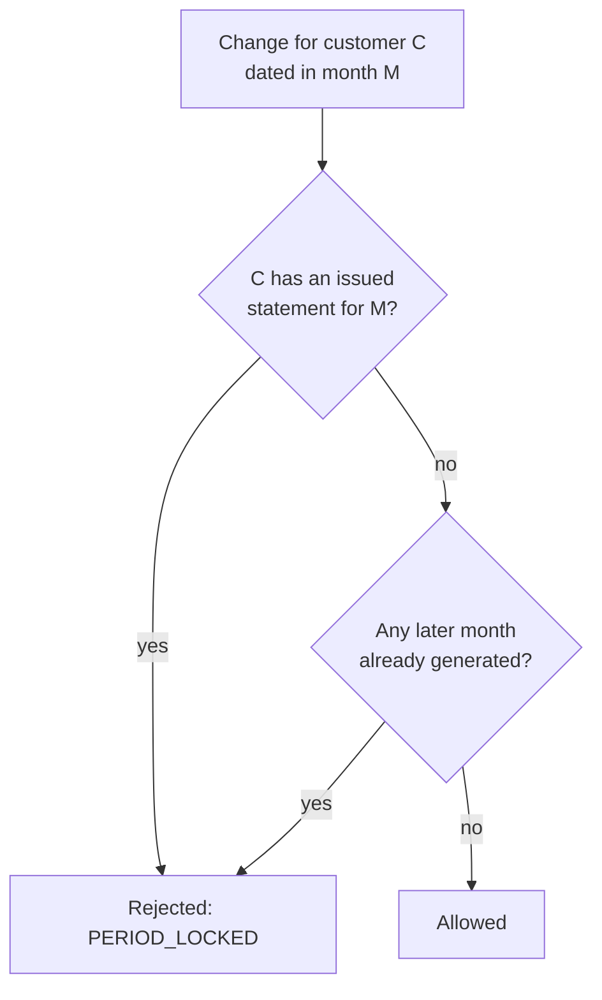

</details>

The lock applies to:
- marking an order delivered;
- creating or deleting a payment;
- creating or deleting an adjustment.

### 5.6 Monthly billing lifecycle


<details>
<summary>Diagram source (Mermaid)</summary>

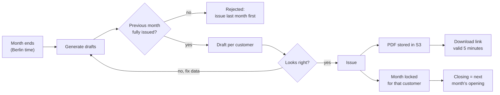

</details>

### 5.7 PDF bill contents
- Business name and address
- Customer name and address
- Invoice number `YYYY-MM-<customer id>`, issue date and billing period
- Every delivered order line: date, product, quantity, unit price and line total
- Opening balance, orders, payments, adjustments, and **Amount due** (or **Credit** when negative)
- The note: `Gemäß § 19 UStG wird keine Umsatzsteuer berechnet.`
- Layout: A4, `dd.mm.yyyy` dates, German number format (`1.234,56 €`), and no external fonts or images

### 5.8 Anonymisation (GDPR)
- The name becomes `Anonymised customer #<id>`; phone, address and notes are cleared.
- The customer is set inactive, and `anonymised_at` is set.
- Orders and statements are kept for invoice retention.
- The customer's data is removed from the search index.
- An anonymised customer can't be edited or reactivated.

---

## 6. API

### 6.1 Conventions
- **Base path:** `/api/v1`, JSON only.
- **Auth:** a Cognito **access token** in `Authorization: Bearer …` on every route except `GET /health`.
- **Headers:** every response has an `X-Request-ID`. An incoming valid UUID is reused; otherwise a new one is created.
- **Lists:** `{"items": [...], "total": n}` with `limit` (default 50, max 200) and `offset`.
- **Formats:** money in cents, dates `YYYY-MM-DD`, months `YYYY-MM`.
- **Docs:** the OpenAPI schema is exported to `backend/openapi.json`, and the frontend generates its TypeScript types from it.

### 6.2 Endpoints

| Area | Method and path | Purpose |
|---|---|---|
| System | `GET /health` | Liveness check, no login needed |
| | `GET /me` | Current username |
| Customers | `GET /customers?q=&include_inactive=&limit=&offset=` | Search and list |
| | `POST /customers` | Create |
| | `GET /customers/{id}` | Detail, with `balance_cents` |
| | `PATCH /customers/{id}` | Edit |
| | `POST /customers/{id}/deactivate` · `/activate` · `/anonymise` | Lifecycle |
| Products and rates | `GET /products?on=YYYY-MM-DD` | Products with the price for that date |
| | `GET /products/{id}/rates` | Price history, newest first |
| | `POST /rates` | New price from a date |
| Orders | `GET /orders?date_from=&date_to=&status=&customer_id=` | List and filter |
| | `POST /orders` | Create (prices copied in) |
| | `GET /orders/{id}` | Detail |
| | `PUT /orders/{id}` | Replace (only `pending` or `confirmed`) |
| | `POST /orders/{id}/status` | Move to the next status, or cancel |
| Payments | `GET /payments?customer_id=&month=` | List |
| | `POST /payments` · `DELETE /payments/{id}` | Record or remove |
| Adjustments | `GET /adjustments?customer_id=&month=` | List |
| | `POST /adjustments` · `DELETE /adjustments/{id}` | Add or remove |
| Statements | `POST /statements/generate` `{month}` | Create or refresh drafts |
| | `GET /statements?month=&customer_id=` | List |
| | `GET /statements/{id}` | Detail with lines |
| | `POST /statements/{id}/issue` | Lock and create the PDF |
| | `GET /statements/{id}/pdf` | `{url}`, valid 300 seconds |
| Dashboard | `GET /dashboard` | Today's counts, baking totals, outstanding |
| Search | `GET /search?q=&kind=&status=&month=&limit=` | Hits, facet counts, product totals |
| | `POST /search/reindex` | Rebuild the index from Postgres |

### 6.3 Error format and codes

```json
{"error": {"code": "PERIOD_LOCKED", "message": "This month is already billed.", "field": "paid_on"}}
```

| Code | HTTP | Message shown in the app |
|---|---|---|
| `VALIDATION_ERROR` | 422 | Please check the highlighted field. |
| `UNAUTHORIZED` | 401 | Your session has expired. Please sign in again. |
| `NOT_FOUND` | 404 | This item no longer exists. |
| `NO_RATE_FOR_DATE` | 422 | No price is set for this date. Add a rate first. |
| `INVALID_STATUS_TRANSITION` | 409 | This order can't move to that status. |
| `ORDER_NOT_EDITABLE` | 409 | Orders can only be edited before prep starts. |
| `CUSTOMER_INACTIVE` | 409 | This customer is inactive. |
| `PERIOD_LOCKED` | 409 | This month is already billed for this customer. |
| `RATE_EXISTS` | 409 | A price already starts on this date. |
| `PREVIOUS_MONTH_NOT_ISSUED` | 409 | Issue last month's bills first. |
| `LATER_MONTH_GENERATED` | 409 | A later month has already been generated. |
| `MONTH_NOT_ENDED` | 409 | Bills can be issued after the month ends. |
| `STATEMENT_ALREADY_ISSUED` | 409 | This bill is already issued. |
| `STATEMENT_NOT_ISSUED` | 409 | Issue this bill before downloading it. |
| `INTERNAL_ERROR` | 500 | Something went wrong. Reference: `<request id>` |

`field` is a dotted path such as `items.0.quantity`, or `null`. Internal errors never reveal details; the request ID links the message to the log entry.

---

## 7. Backend architecture

### 7.1 Layers

Routes stay thin, and services coordinate the work. The business rules in `domain/` are pure Python with no database or framework imports, so they test in milliseconds.


<details>
<summary>Diagram source (Mermaid)</summary>

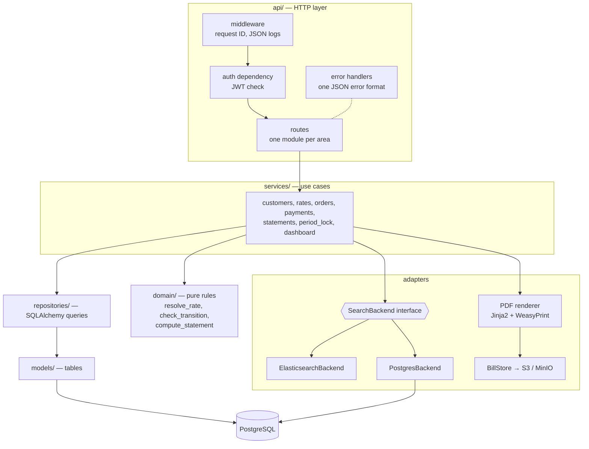

</details>

### 7.2 Module map

```
backend/app/
  main.py            create_app(settings, jwks_provider, bill_store, search_backend)
  config.py          Settings from environment variables
  clock.py           today_berlin, month helpers
  money.py           format_eur
  errors.py          ErrorCode, DomainError
  auth.py            verify_access_token, CurrentUser
  db.py              session factory, get_session (commit, then search sync)
  storage.py         BillStore, S3BillStore
  secrets.py         read SSM parameters at cold start
  lambda_handler.py  Mangum adapter
  seed_demo.py       demo data and nightly reset
  domain/            enums, pricing, order_status, statements
  models/            SQLAlchemy tables
  repositories/      queries
  services/          use cases
  schemas/           Pydantic request and response models
  api/               middleware, error handlers, routes
  pdf/               bill template and renderer
  search/            mapping, documents, backends, sync, reindex
```

### 7.3 Request handling inside the API


<details>
<summary>Diagram source (Mermaid)</summary>

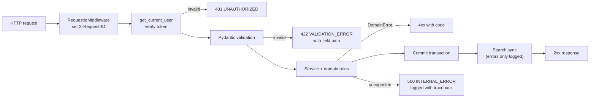

</details>

### 7.4 Configuration

| Setting | Local | Demo / prod |
|---|---|---|
| `ENVIRONMENT` | `local` | `demo` / `prod` |
| `DATABASE_URL` | Docker Postgres | from SSM (`SSM_DATABASE_URL`) |
| `AUTH_MODE` | `dev` (token `dev-token`) | `cognito`; `dev` is refused outside local |
| `COGNITO_ISSUER`, `COGNITO_CLIENT_ID` | — | From Terraform outputs |
| `CORS_ORIGINS` | `["http://localhost:4200"]` | The CloudFront domain |
| `BILLS_BUCKET`, `S3_ENDPOINT_URL` | MinIO | S3 (no endpoint override) |
| `SEARCH_BACKEND`, `ELASTICSEARCH_URL` | `elasticsearch`, `http://localhost:9200` | `postgres` |
| `BUSINESS_NAME`, `BUSINESS_ADDRESS` | Demo values | Your business details |

---

## 8. Frontend architecture

### 8.1 Structure

The app uses standalone components, signals and lazy-loaded pages. Everything that talks to the outside world sits in `core/`, so pages contain only screen logic.


<details>
<summary>Diagram source (Mermaid)</summary>

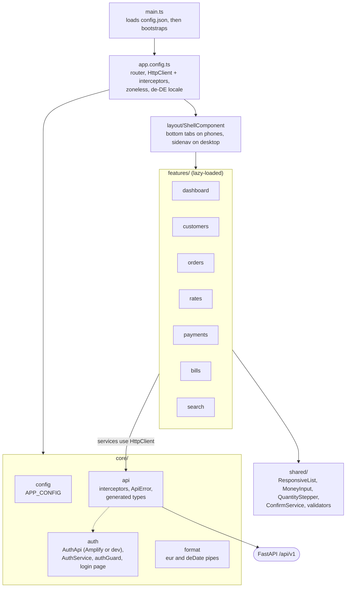

</details>

### 8.2 Routes and navigation


<details>
<summary>Diagram source (Mermaid)</summary>

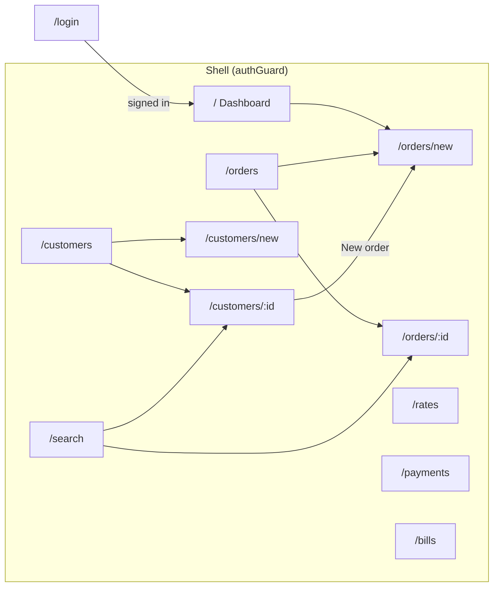

</details>

- **Phone navigation:** bottom tabs for Dashboard, Orders and Customers, plus **More** (Search, Rates, Payments, Bills, Sign out).
- **Desktop navigation (from 1024px):** a sidenav with every item.

### 8.3 Screens

| Screen | What it does |
|---|---|
| Login | Email and password, then a new password on first sign-in, MFA setup with a QR code, and the 6-digit code |
| Dashboard | Today's date; what to bake today per product; order counts per status (each links to a filtered list); outstanding total; New order |
| Customers | Search (300 ms debounce) and an inactive toggle; create and edit form; detail page with balance ("Owes 8,50 €" or "Credit 2,00 €"), the last 20 orders, and the actions |
| Orders | Filter by date and status; cards with the next-action button (Confirm, Start prep, Mark delivered) and Cancel. The new-order form has a +/− stepper per product and a sticky total. |
| Rates | Current price per product, price history, and "Set new price" from a date |
| Payments | Record a payment; list it by month and customer; monthly balances per customer |
| Bills | Choose a month; Generate drafts; Issue (with confirmation) or Issue all; Download PDF |
| Search | One search box; filter chips with counts (kind, status, month); results linking to customers and orders; product totals. All state is in the URL. |

### 8.4 Mobile layout


<details>
<summary>Diagram source (Mermaid)</summary>

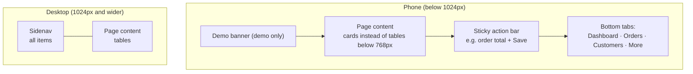

</details>

- Works from 360px wide with no horizontal scrolling.
- Touch targets are at least 44×44px, and inputs at least 16px, so iOS doesn't zoom in.
- Number inputs open the numeric keypad, and MFA codes use one-time-code autofill.
- PDFs open in the phone's own viewer.

### 8.5 HTTP pipeline and error handling


<details>
<summary>Diagram source (Mermaid)</summary>

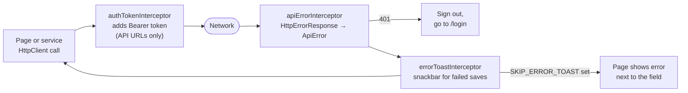

</details>

### 8.6 Runtime configuration

`config.json` is fetched before the app starts, so one build serves every environment.

```json
{ "apiBaseUrl": "/api/v1", "authMode": "cognito", "cognitoUserPoolId": "eu-central-1_xxx", "cognitoClientId": "xxx", "demo": true }
```

---

## 9. Key flows

### 9.1 First sign-in with MFA


<details>
<summary>Diagram source (Mermaid)</summary>

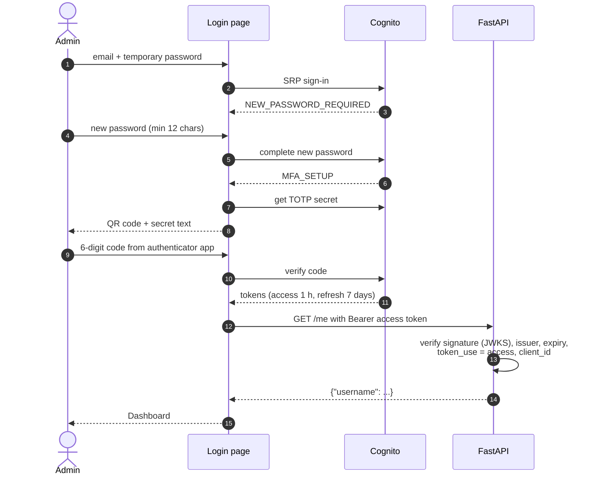

</details>

On later sign-ins: email and password, then the 6-digit code.

### 9.2 Placing an order


<details>
<summary>Diagram source (Mermaid)</summary>

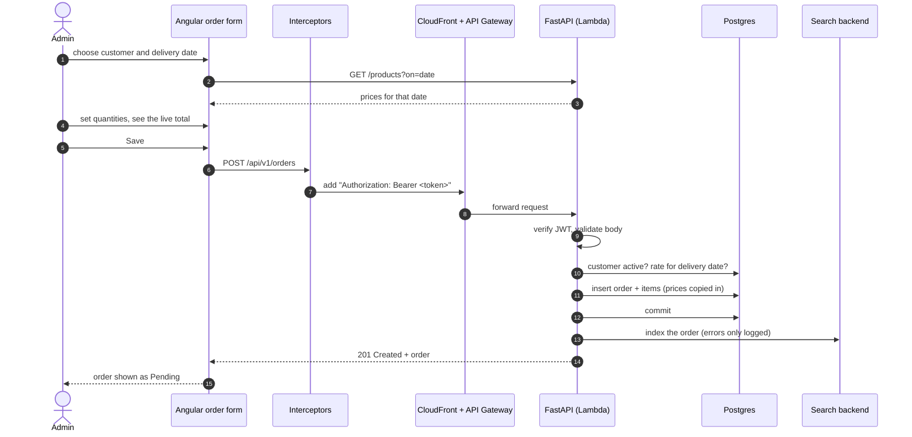

</details>

### 9.3 Generating and issuing a monthly bill


<details>
<summary>Diagram source (Mermaid)</summary>

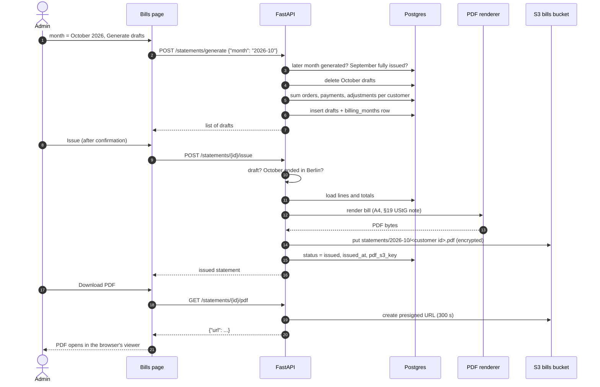

</details>

### 9.4 Search


<details>
<summary>Diagram source (Mermaid)</summary>

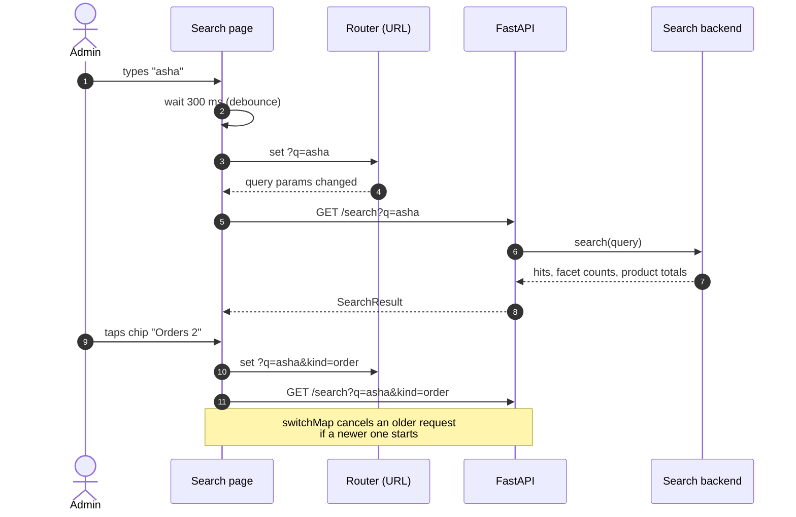

</details>

### 9.5 Nightly demo reset


<details>
<summary>Diagram source (Mermaid)</summary>

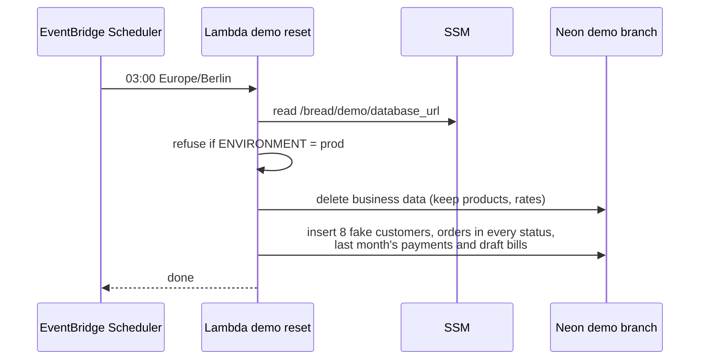

</details>

---

## 10. Search and analysis

### 10.1 Design
- Postgres is the source of truth. The search index is a copy that can be rebuilt at any time.
- One `SearchBackend` interface has two implementations with the same response shape:
  - **Elasticsearch** (local and CI): typo tolerance, highlights, nested aggregations.
  - **Postgres** (AWS): `ILIKE` matching, `GROUP BY` counts. AWS has no free Elasticsearch.


<details>
<summary>Diagram source (Mermaid)</summary>

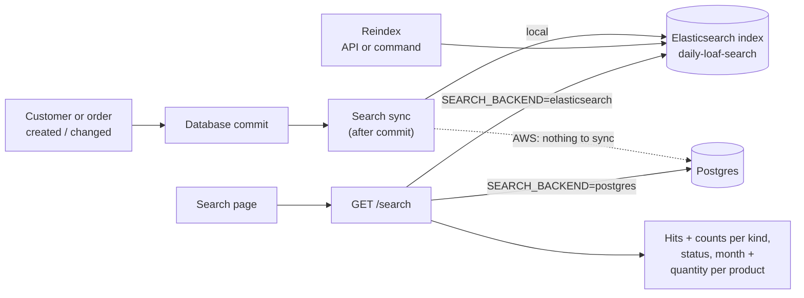

</details>

### 10.2 Index documents


<details>
<summary>Diagram source (Mermaid)</summary>

```mermaid
classDiagram
    class SearchDocument {
        keyword kind  "customer | order"
        integer entity_id
        integer customer_id
        text customer_name  "folded analyzer + raw keyword"
        text customer_phone
        text notes
        boolean is_active
        date delivery_date
        keyword month
        keyword status
        keyword source
        integer total_cents
        nested items
    }
    class Item {
        keyword product_code
        text product_name
        integer quantity
    }
    SearchDocument "1" *-- "0..*" Item : items (nested)
```

</details>

- **Index:** `daily-loaf-search`. Document IDs are `customer-<id>` and `order-<id>`.
- **Analyzer `folded`:** the standard tokenizer, then `lowercase` and `asciifolding`, so "Müller" matches "muller".
- **`items` is nested,** so each item's product and quantity stay together for correct per-product totals.
- **Query:** free text over name (boosted ×3), phone, notes and product names, with `fuzziness: AUTO`. Filters on kind, status and month.
- **Aggregations:** counts per kind, status and month, plus the summed quantity per product code.
- **Highlights** use the HTML encoder, so database text is escaped and only `<em>` is added.

### 10.3 Response shape

```json
{
  "total": 3,
  "hits": [{"kind": "order", "id": 12, "title": "Order #12 · Asha Patil", "subtitle": "20× Mini pav",
            "delivery_date": "2026-11-05", "status": "pending", "total_cents": 800, "highlight": "<em>Asha</em> Patil"}],
  "facets": {"kind": {"customer": 1, "order": 2}, "status": {"pending": 2}, "month": {"2026-11": 1, "2026-10": 1}},
  "product_totals": [{"product_code": "MINI_PAV", "product_name": "Mini pav", "quantity": 30}]
}
```

---

## 11. Security

### 11.1 Layers


<details>
<summary>Diagram source (Mermaid)</summary>

```mermaid
flowchart TB
    u(["Browser"]) --> l1["CloudFront<br/>HTTPS only, HSTS, CSP,<br/>X-Frame-Options DENY, nosniff"]
    l1 --> l2["API Gateway<br/>rate limit 10/s, burst 20"]
    l2 --> l3["FastAPI<br/>JWT check on every route,<br/>Pydantic validation, CORS = own origin"]
    l3 --> l4["Services<br/>business rules, period lock"]
    l4 --> l5["Data<br/>ORM only (no SQL injection),<br/>TLS to Neon, encrypted S3, private bucket"]
    l6["IAM<br/>least privilege per Lambda"] -.-> l3
    l7["Cognito<br/>no self sign-up, MFA,<br/>12-char passwords"] -.-> l3
```

</details>

### 11.2 Controls

| Area | Control |
|---|---|
| Identity | Cognito pool per environment. Admins are created by an admin; there is no self sign-up. MFA (authenticator app) is required in prod. Passwords have at least 12 characters of mixed types. Access tokens last 1 hour, refresh tokens 7 days. |
| API | The token's signature, issuer, expiry, `token_use` and `client_id` are checked on every request. Dev login works only when `ENVIRONMENT=local`. Input is validated by Pydantic. Internal errors never reveal details. |
| Browser | A strict CSP: only `self` plus Cognito for `connect-src`. Angular sanitises HTML. Fonts are self-hosted, with no Google Fonts (GDPR). |
| Data | TLS everywhere. Neon encrypts at rest. The S3 bills bucket is private, encrypted and TLS-only, and PDFs are reached only through 5-minute presigned links. |
| Secrets | The database URL lives in SSM SecureString, read at cold start. Nothing secret is stored in Git, Terraform variables or GitHub. |
| AWS access | Each Lambda has a role with only what it needs. GitHub deploys through OIDC roles limited to `main` and the `prod` environment. |
| Supply chain | Dependabot, `pip-audit`, `npm audit`, bandit, gitleaks, GitHub secret scanning with push protection, and branch protection on `main`. |
| GDPR | All data is stored in the EU (Frankfurt). The demo holds only fake data. Customers can be anonymised. There are no third-party trackers. |
| Local only | Elasticsearch runs without security, reachable only from your own machine. |

---

## 12. Infrastructure

Terraform defines everything. State is stored in an encrypted S3 bucket with a DynamoDB lock table. There is one module per environment.


<details>
<summary>Diagram source (Mermaid)</summary>

```mermaid
flowchart TB
    subgraph boot["infra/bootstrap (once)"]
        st[("S3 bread-tfstate-<account>")]
        lock[("DynamoDB bread-tf-locks")]
    end

    subgraph mod["infra/modules/app (per environment)"]
        cog["Cognito user pool + web client"]
        s3w[("S3 bread-web-<env>")]
        s3b[("S3 bread-bills-<env>")]
        ecr["ECR bread-api-<env>"]
        lam["Lambda bread-api-<env><br/>1024 MB, 30 s, max 5 concurrent"]
        rst["Lambda bread-demo-reset<br/>+ Scheduler (demo only)"]
        gw["API Gateway HTTP API<br/>ANY /api/{proxy+}"]
        cfd["CloudFront + OAC<br/>+ SPA rewrite function<br/>+ security headers policy"]
        mon["CloudWatch logs (30 days)<br/>+ alarms → SNS email"]
        oidc["IAM: GitHub OIDC roles<br/>deploy + plan"]
    end

    envs["infra/envs/demo · infra/envs/prod"] --> mod
    mod -.->|"state"| st
    cfd --> s3w
    cfd --> gw --> lam
    ecr --> lam
    lam --> s3b
    lam --> mon
```

</details>

| Resource | Key settings |
|---|---|
| CloudFront | `/api/*` goes to API Gateway with caching off; everything else goes to S3 with caching on. HTTP/2 and HTTP/3. `index.html` and `config.json` are never cached. |
| SPA rewrite | Any path without a file extension is served `index.html`, so deep links like `/orders/12` work. |
| Lambda | Container image (x86_64). Reserved concurrency of 5 caps cost and abuse. |
| Cognito | Deletion protection on in prod. Email is the username. |
| Budget | AWS Budgets alert at €5 per month. |

---

## 13. Delivery pipeline


<details>
<summary>Diagram source (Mermaid)</summary>

```mermaid
flowchart LR
    dev["Feature branch"] --> pr["Pull request"]
    pr --> ci["CI checks<br/>lint, types, tests,<br/>security scans, terraform plan"]
    ci -->|"green"| main["Merge to main"]
    main --> dd["Deploy demo<br/>image → ECR → Lambda,<br/>migrations, frontend → S3"]
    dd --> e2e["Playwright e2e<br/>desktop + phone"]
    main --> tag["Tag v*"]
    tag --> appr{"Manual approval"}
    appr --> dp["Deploy prod"]
    gh["GitHub Actions"] -.->|"OIDC, no stored AWS keys"| dd
    gh -.-> dp
```

</details>

| Workflow | Trigger | Steps |
|---|---|---|
| `backend` | PR or push touching `backend/` | ruff, mypy strict, pytest (Postgres and Elasticsearch in Testcontainers), coverage of at least 85%, pip-audit, bandit, OpenAPI schema unchanged, Docker build |
| `frontend` | PR or push touching `frontend/` | Types match `openapi.json`, angular-eslint, Prettier, unit tests, npm audit, production build |
| `security` | PR, push, weekly | gitleaks |
| `infra` | PR touching `infra/` | `terraform plan` for demo and prod |
| `deploy-demo` | Merge to `main` | Build and push the image, run migrations, update the Lambdas, upload the frontend and `config.json`, invalidate CloudFront, run Playwright |
| `deploy-prod` | Tag `v*` + approval | The same without the reset Lambda and without e2e tests |

Terraform `apply` stays manual, run from your laptop.

---

## 14. Testing


<details>
<summary>Diagram source (Mermaid)</summary>

```mermaid
flowchart TB
    e2e["End-to-end (Playwright)<br/>order → delivered → payment → bill → PDF<br/>desktop + Pixel 7, no horizontal scroll"]
    integ["Integration (pytest + Testcontainers)<br/>API endpoints, auth, validation, migrations,<br/>search contract on both backends"]
    fe["Frontend unit (Angular Testing Library)<br/>components, forms, interceptors, guards, pipes"]
    unit["Backend unit (pytest)<br/>rate lookup, status rules, statement maths,<br/>Berlin dates, money format"]
    e2e --> integ --> fe --> unit
```

</details>

The list runs from few, slow tests at the top to many, fast tests at the bottom.

| Rule | Value |
|---|---|
| Approach | Test-first for business rules |
| Backend coverage | At least 85% (CI fails below that) |
| Test data | Faker (`de_DE`, seed 42); never real customers |
| Time-sensitive tests | Frozen clocks, e.g. 23:30 UTC = next day in Berlin |
| Edge cases covered | Quantity 0, duplicate products, no rate for the date, inactive customer, locked month, issuing before month end, escaped search highlights, index down |

---

## 15. Observability and cost


<details>
<summary>Diagram source (Mermaid)</summary>

```mermaid
flowchart LR
    api["Lambda logs<br/>JSON + request_id"] --> cw["CloudWatch Logs<br/>30-day retention"]
    cw --> al1["Alarm: Lambda errors ≥ 1 in 5 min"]
    gw["API Gateway"] --> al2["Alarm: 5xx ≥ 1 in 5 min"]
    al1 --> sns["SNS topic"] --> mail(["Email to you"])
    al2 --> sns
    bud["AWS Budgets €5/month"] --> mail
```

</details>

- Every log line has `timestamp`, `level`, `logger`, `message` and `request_id`. Tokens and connection strings are never logged.
- The error message the user sees includes the request ID, so a problem can be found in the logs quickly.

**Expected monthly cost:** about €0–1. Lambda, API Gateway, CloudFront, S3 and Cognito all stay within their free tiers at this size, and Neon's free plan has no time limit.

---

## 16. Key decisions

| Decision | Why | Trade-off |
|---|---|---|
| Serverless (Lambda, S3, CloudFront) | Close to €0 for two users; nothing to patch | Cold starts of about 1–2 seconds |
| Neon Postgres instead of AWS RDS | Free with no 12-month limit; still SQL | The database sits outside AWS |
| Angular frontend | Matches the target roles, e.g. the BKA posting | — |
| Python FastAPI backend | Typed, fast, generates OpenAPI; in demand | — |
| Runtime `config.json` | One frontend build for every environment | One extra request at startup |
| Money as integer cents | No rounding errors | Converted for display |
| Prices copied into order items | Old bills never change when rates change | Slight duplication |
| Billing-period lock and months in sequence | Issued bills stay correct, and no month is skipped | Corrections go through adjustments |
| Elasticsearch locally, Postgres search on AWS | Shows Elasticsearch skills without a monthly cost | Typo tolerance only works locally |
| Search updated after commit, failures only logged | Saving never fails because of search | The index can lag until a reindex |
| GitHub OIDC instead of AWS keys | No long-lived secrets in GitHub | One-time IAM setup |
| Terraform apply by hand | A mistake in CI can't destroy infrastructure | A manual step |

---

## 17. Open points

1. Is the second admin known now, or is prod set up with only your account first?
2. Should the demo login be in the README directly, or only shared on request?
3. Is a cold start of about 1–2 seconds after a quiet period acceptable on your phone?
4. What business name and address should appear on the bills?
